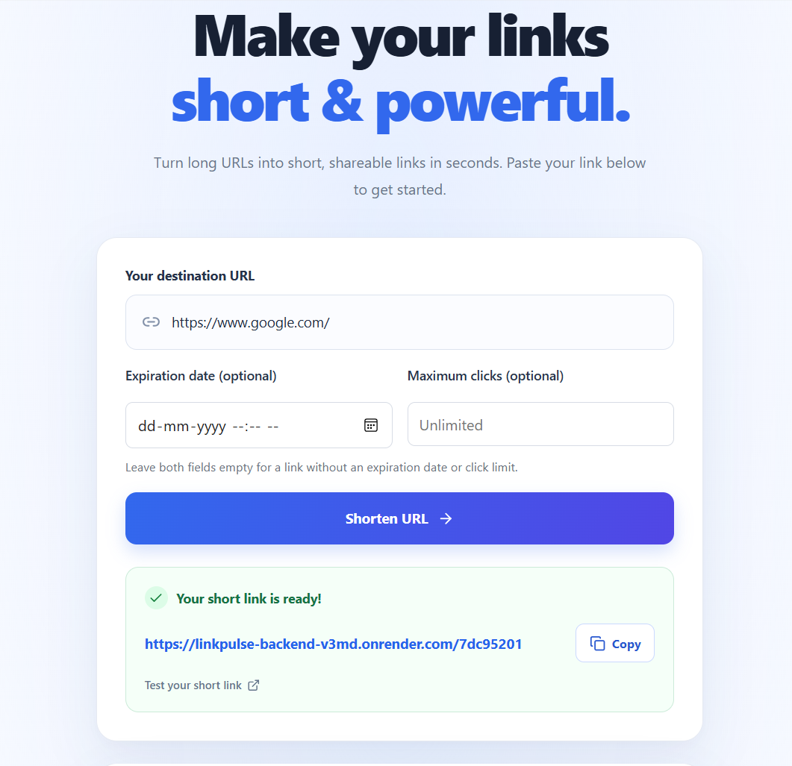
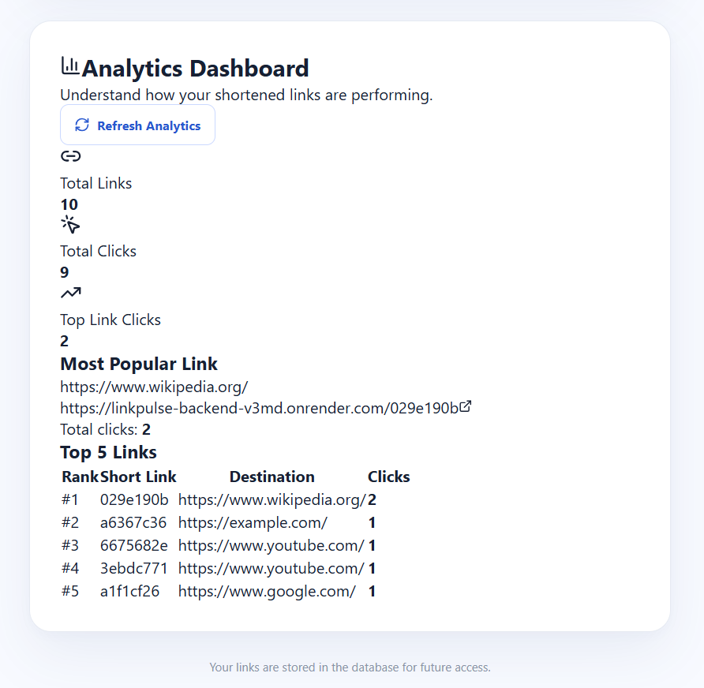
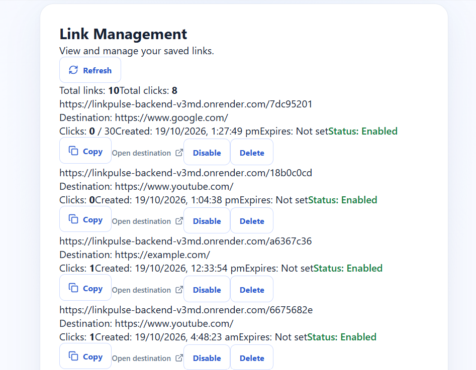
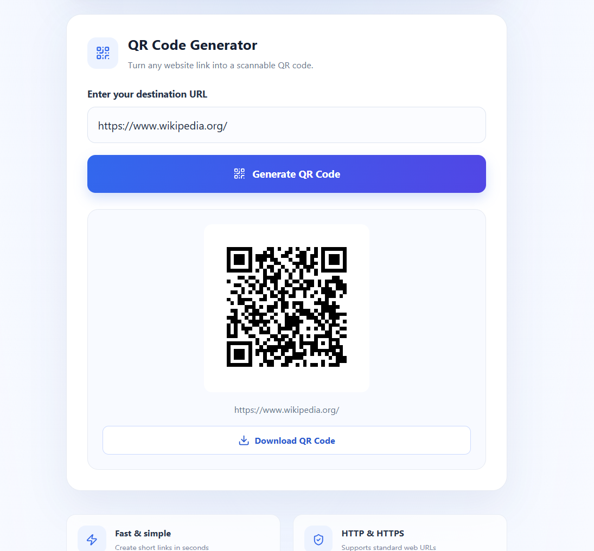

# 🔗 LinkPulse — Smart URL Shortener

### Shorten Links. Share Smarter. Track Better.

**LinkPulse** is a full-stack URL shortener designed to simplify link sharing and management. It allows users to shorten long URLs, manage their links, track clicks, and generate QR codes for convenient sharing.

## 🚀 Live Demo

* **Live Website:** https://linkpulse-rust.vercel.app/
* **Backend API:** https://linkpulse-backend-v3md.onrender.com
* **GitHub Repository:** https://github.com/SAUMYA19-CODER/syntax-squad-linkpulse

## 📌 Problem Statement

Long URLs can be difficult to share, remember, and manage. They often look untidy and provide limited information about link engagement.

Users need a simple and efficient solution to shorten URLs, organize their links, and monitor their performance.

## 💡 Our Solution

LinkPulse provides a user-friendly web application that converts long URLs into short links. Users can manage their shortened URLs, track clicks, and generate QR codes to make sharing easier.

The application connects a frontend interface with a backend API and a database to store and manage URL information.

## ✨ Features

* **URL Shortening:** Convert long URLs into short, shareable links.
* **Link Management:** View and manage created short URLs.
* **Delete Links:** Remove links that are no longer required.
* **Click Tracking:** Monitor clicks on shortened URLs.
* **QR Code Generation:** Generate QR codes for convenient link sharing.
* **Database Integration:** Store and manage URL information.
* **REST API:** Connect the frontend and backend.
* **User-Friendly Interface:** Access features through a simple interface.

## 🛠️ Tech Stack

### Frontend

* HTML
* CSS
* JavaScript
* React (if used in the current frontend)

### Backend

* Node.js
* Express.js

### Database

* MySQL
* Aiven Cloud Database

### Deployment

* Vercel — Frontend hosting
* Render — Backend hosting
* Aiven — Cloud database hosting

## 📂 Project Structure

```text
syntax-squad-linkpulse/
│
├── backend/
│   ├── server.js
│   ├── package.json
│   └── ...
│
├── frontend/
│   └── ...
│
├── screenshots/
│   ├── analytics.png
│   ├── link-management.png
│   ├── qr-code.png
│   ├── homepage.png
│   └── .gitkeep
│
├── .gitignore
└── README.md
```

*Note: This is an illustrative structure. The actual folder names and files may differ.*

## ⚙️ Installation and Setup

### Prerequisites

* Node.js and npm
* Git
* MySQL database

### 1. Clone the Repository

```bash
git clone https://github.com/SAUMYA19-CODER/syntax-squad-linkpulse.git
```

### 2. Navigate to the Project Directory

```bash
cd syntax-squad-linkpulse
```

### 3. Install Backend Dependencies

```bash
cd backend
npm install
```

### 4. Configure Environment Variables

Create a `.env` file inside the backend directory.

Add the database connection details and other required environment variables using the exact variable names expected by your backend code.

**Important:** Never upload your `.env` file, database password, or other sensitive credentials to GitHub.

### 5. Start the Backend

If `server.js` is the backend entry point, run:

```bash
node server.js
```

Alternatively, use the start command defined in your backend's `package.json`.

### 6. Start the Frontend

Open another terminal, navigate to the frontend directory, install the required dependencies, and run the development command specified in the frontend's `package.json`.

## 📸 Project Screenshots

### 1. Homepage

The homepage introduces LinkPulse and provides access to its URL-shortening functionality.



### 2. Analytics Dashboard

The analytics dashboard displays information about the performance and usage of shortened links.



### 3. Link Management

The link management interface allows users to view and manage their shortened URLs.



### 4. QR Code Generation

The QR code feature makes it easier to share shortened URLs using scannable QR codes.



## 🔐 Security

* Store sensitive configuration values in environment variables.
* Exclude `.env` files from version control.
* Protect database credentials.
* Validate URLs before processing them.
* Use secure connections for production services.

## 👥 Team Members

* **Paras Pandey** — Team Lead
* **Saumya Singh** — Team Member
* **Shruti Gumber** — Team Member
* **Urmila Fulara** — Team Member

## 🎯 Project Objective

The objective of LinkPulse is to simplify URL sharing and link management through a practical web application that combines URL shortening, link management, click tracking, and QR code generation.

## 📈 Future Enhancements

* User authentication and personalized dashboards.
* Advanced link analytics and reporting.
* Custom short URLs.
* Link expiration settings.
* Enhanced security and access controls.

## 📄 License

Developed as a team project. A license can be added if the team decides to distribute the project under specific licensing terms.
